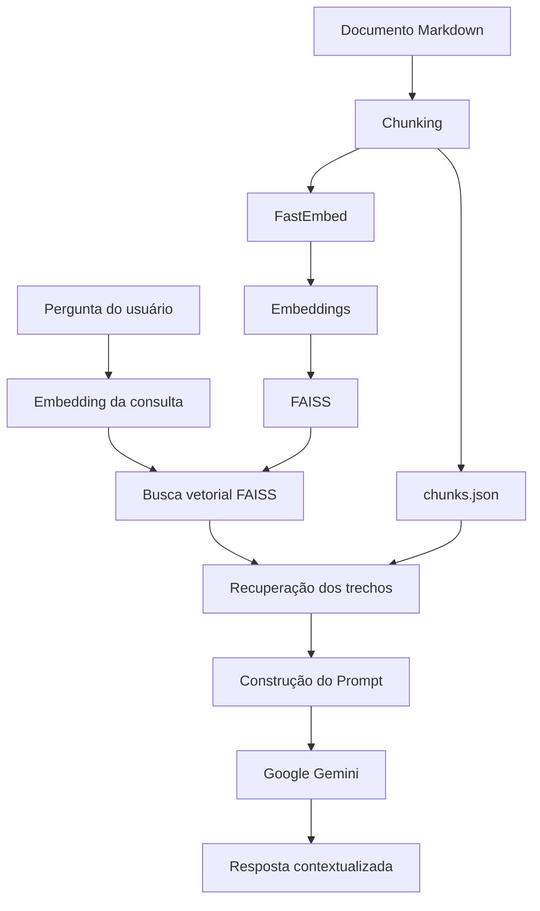

# 🍕 iFood RAG Copilot

### Copiloto inteligente de suporte operacional para parceiros iFood

Um sistema de **RAG (Retrieval-Augmented Generation)** que combina busca semântica e inteligência artificial generativa para responder dúvidas sobre políticas operacionais, cancelamentos, reembolsos e repasses financeiros.

Desenvolvido como projeto prático de **Engenharia de IA**, com foco em NLP, embeddings locais, recuperação contextual de informações e mitigação de alucinações em respostas geradas por LLMs.

<p align="center">
  
  
  
  
</p>

---

## 📌 Visão Geral

O projeto implementa um pipeline RAG capaz de interpretar perguntas em linguagem natural, recuperar trechos relevantes de uma base de conhecimento e utilizá-los como contexto para gerar respostas fundamentadas.

**Principais objetivos:**

- Reduzir respostas sem fundamento por meio de recuperação contextual.
- Utilizar embeddings locais para diminuir a dependência de serviços externos na etapa de busca.
- Recuperar informações por similaridade semântica, não apenas por palavras-chave.
- Orientar a LLM a responder exclusivamente com base no contexto disponibilizado.

## 🏗️ Arquitetura

O sistema está dividido em dois pipelines principais:

### 1. Pipeline de ingestão — `app/ingest.py`

Responsável por preparar a base de conhecimento para pesquisas semânticas.

- Leitura de documentos em Markdown.
- Divisão dos documentos em pequenos trechos (*chunking*).
- Geração de embeddings com FastEmbed.
- Normalização dos vetores.
- Indexação vetorial utilizando FAISS.
- Persistência dos documentos e índices para consultas posteriores.

### 2. Pipeline de recuperação e geração — `app/rag.py`

Responsável por interpretar as perguntas e produzir respostas contextualizadas.

- Recebimento da pergunta em linguagem natural.
- Geração do embedding da consulta.
- Busca dos documentos mais relevantes no FAISS.
- Recuperação dos trechos originais armazenados em JSON.
- Construção dinâmica do contexto e do prompt.
- Consulta à API Google Gemini.
- Retorno da resposta fundamentada nos documentos recuperados.

### 🔄 Fluxo de funcionamento



## 🛠️ Stack Tecnológica

| Tecnologia | Aplicação |
|---|---|
| Python 3.13 | Linguagem principal |
| FastEmbed | Geração local de embeddings |
| MiniLM Multilingual | Modelo de representação semântica |
| FAISS CPU | Indexação e busca vetorial |
| NumPy | Manipulação de vetores numéricos |
| Google Gemini API | Geração de respostas |
| JSON | Persistência dos documentos processados |
| python-dotenv | Gerenciamento de variáveis de ambiente |

### Modelo de Embeddings

`sentence-transformers/paraphrase-multilingual-MiniLM-L12-v2`

Modelo multilíngue utilizado para representar semanticamente os textos e perguntas, permitindo a recuperação de informações em português.

### Vector Store

**FAISS (Facebook AI Similarity Search)**

Utilizado para realizar buscas vetoriais eficientes através de similaridade entre embeddings normalizados.

### LLM

**Google Gemini 2.5 Flash**

Responsável pela interpretação do contexto recuperado e geração de respostas em linguagem natural.

## 📚 Base de Conhecimento

O copiloto utiliza uma documentação estruturada em Markdown:

`data/politicas_parceiros.md`

A base contempla os seguintes assuntos:

| Categoria | Conteúdo |
|---|---|
| Cancelamentos | Regras de cancelamento antes e depois do preparo |
| Responsabilidade | Atrasos na coleta e na entrega |
| Reembolsos | Itens faltantes e pedidos incorretos |
| Contestações | Prazos e procedimentos de contestação |
| Financeiro | Repasses e divergências de valores |
| Operações | Indisponibilidade de produtos e problemas de coleta |

> **Observação:** a documentação utilizada neste projeto é demonstrativa e não representa necessariamente as políticas oficiais vigentes do iFood.

## 🚀 Como Executar Localmente

### 1. Clonar o repositório

```bash
git clone https://github.com/SEU-USUARIO/ifood-rag-copilot.git

cd ifood-rag-copilot
```

### 2. Criar o ambiente virtual

```bash
python -m venv venv
```

Ativar no Windows:

```powershell
venv\Scripts\activate
```

Linux/macOS:

```bash
source venv/bin/activate
```

### 3. Instalar as dependências

```bash
pip install fastapi uvicorn fastembed faiss-cpu numpy google-genai python-dotenv requests
```

### 4. Configurar a API do Gemini

Crie um arquivo `.env` na raiz do projeto:

```env
GEMINI_API_KEY=sua_chave_aqui
```

**Importante:** nunca compartilhe sua chave de API. O arquivo `.env` está protegido pelo `.gitignore` e não deve ser enviado ao GitHub.

### 5. Gerar a base vetorial

Os arquivos `index.faiss` e `chunks.json` são gerados localmente e não são versionados no Git, pois a pasta `vectorstore/` está incluída no `.gitignore`.

Após clonar o projeto, execute:

```bash
python app/ingest.py
```

Esse processo realiza:

- Leitura dos documentos Markdown em `data/`.
- Divisão do conteúdo em trechos (*chunks*).
- Geração dos embeddings com FastEmbed.
- Normalização e indexação dos vetores no FAISS.
- Persistência dos documentos em `chunks.json` e do índice em `index.faiss`.

**Importante:** sempre que os documentos da base de conhecimento forem adicionados ou modificados, execute novamente a ingestão para atualizar o índice vetorial.

### 6. Iniciar o copiloto

```bash
python app/rag.py
```

Após a inicialização, o sistema estará disponível no terminal para receber perguntas sobre os conteúdos documentados.

## 📁 Estrutura do Projeto

```text
ifood-rag-copilot/
│
├── app/
│   ├── ingest.py
│   └── rag.py
│
├── data/
│   └── politicas_parceiros.md
│
├── vectorstore/
│   ├── index.faiss
│   └── chunks.json
│
├── .env
├── .gitignore
└── README.md
```

## 🔬 Evolução Técnica

- [x] Pipeline de ingestão de documentos Markdown.
- [x] Geração local de embeddings.
- [x] Indexação vetorial com FAISS.
- [x] Recuperação semântica de documentos.
- [x] Integração com Google Gemini.
- [x] Construção de prompts com contexto recuperado.
- [x] Base demonstrativa de políticas operacionais.
- [ ] Exposição do motor RAG por meio de uma API REST com FastAPI.
- [ ] Implementação de reranking com Cross-Encoders.
- [ ] Migração para PostgreSQL com pgvector.
- [ ] Implementação de avaliação de qualidade da recuperação e das respostas.
- [ ] Testes automatizados para recuperação e geração.

## 🎯 Objetivo do Projeto

Demonstrar conhecimentos práticos em Engenharia de IA, processamento de linguagem natural, recuperação de informações, bancos vetoriais e integração com modelos de linguagem.

O projeto também explora como arquiteturas RAG podem ser aplicadas em cenários reais de suporte operacional, tornando bases de conhecimento mais acessíveis por meio de interfaces conversacionais.

---

<p align="center">
  Desenvolvido por <strong>Rhuan Oliveira</strong>
  <br />
  <sub>Engenharia de Software • Python • Inteligência Artificial</sub>
</p>